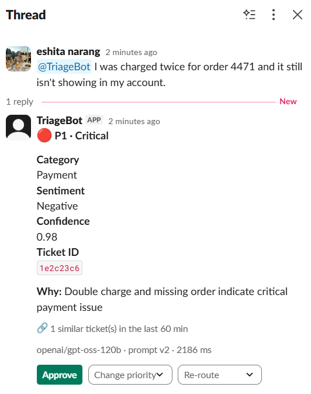
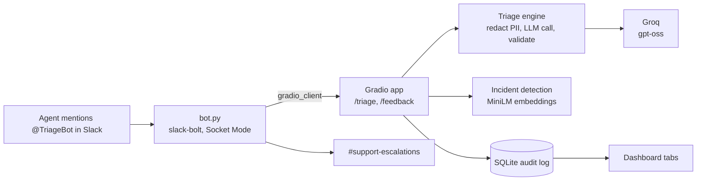
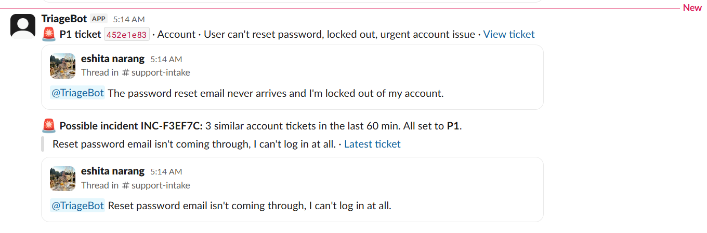
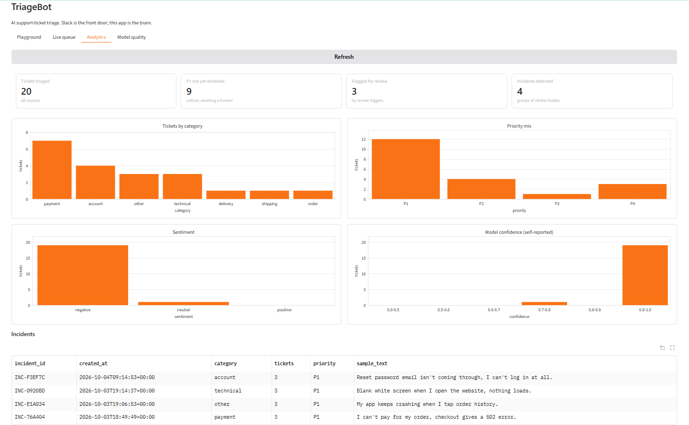
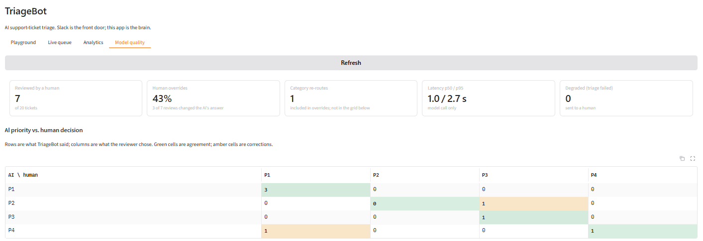
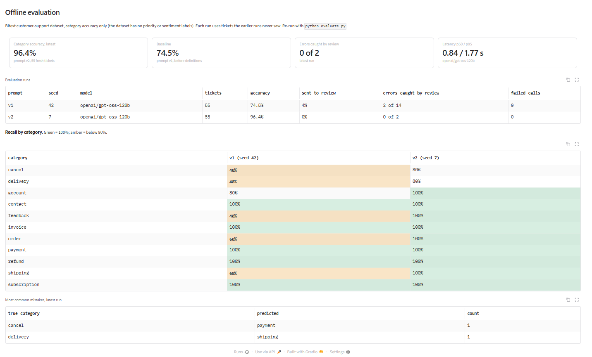

# TriageBot

A Slack bot, built from a Gradio app, that triages customer-support tickets: it assigns a category, a priority (P1 to P4) and a sentiment, routes uncertain tickets to a human, escalates critical ones, and notices when several customers report the same problem at once.

Support agents work in Slack. Team leads use the Gradio app to watch the queue, see how often humans correct the AI, and check accuracy against a labelled dataset.

Built as my flagship project for the Gen AI, LLMs & Agentic AI internship at IIT Jammu (I3C IIT Jammu × Techible).



## Results at a glance

| | |
| --- | --- |
| Category accuracy | **96.4%** on 55 unseen Bitext tickets (up from 74.5% before adding category definitions) |
| Latency | 0.84 s typical, 1.77 s for the slowest 5% (`gpt-oss-120b` on Groq) |
| Running cost | $0: Groq free tier, a local embedding model, a local SQLite database |

Details, and what these numbers do and don't show, are in [Evaluation](#evaluation).

## How it works

The Slack bot holds no triage logic. Following Gradio's guide [Creating a Slack Bot from a Gradio App](https://www.gradio.app/guides/creating-a-slack-bot-from-a-gradio-app), it listens for mentions and calls the Gradio app's API through `gradio_client`. All AI work happens inside the app.



1. An agent writes `@TriageBot <ticket text>` in a channel.
2. The bot posts "Triaging..." in the ticket's thread, then calls `/triage` on the Gradio app.
3. The engine masks emails, phone numbers and card numbers, sends one request to the model, and validates the answer against fixed labels.
4. Deterministic rules can raise the priority (for example, "charged twice" or "payment declined" is always at least P1).
5. The ticket is compared with the last hour's tickets to detect incidents.
6. The bot replaces the placeholder with a triage card. P1 tickets and new incidents are posted to `#support-escalations`.
7. An agent can approve the result or correct it from the card. Every decision and correction is logged.

## Features

**In Slack**
- Triage card in the ticket's thread: priority, category, sentiment, confidence, a one-line reason, and the model and latency
- Human review: Approve, Change priority and Re-route controls on every card, with the reviewer recorded
- "Needs human review" flag with the reason it was raised
- Automatic escalation of P1 tickets, including tickets a human raises to P1
- Incident alerts: when 3 similar tickets arrive within 60 minutes, one alert is posted for the group, not one per ticket

**In the Gradio app**
- **Playground:** triage a ticket and see the raw result
- **Live queue:** every ticket with the AI's labels next to the reviewer's
- **Analytics:** volume by category, priority mix, sentiment, confidence, and detected incidents
- **Model quality:** human override rate, an AI-versus-human priority grid, reasons for review, latency, and the offline evaluation results

**Safeguards**
- PII redaction before any text leaves the machine; only redacted text is stored
- Ticket text is wrapped as data in the prompt, so instructions inside a ticket are ignored
- Model output is validated with Pydantic against fixed labels; an invalid answer is retried once, then sent to a human instead of guessed
- Automatic retries with backoff when Groq's rate limit is hit
- Duplicate Slack events are ignored, so one mention never produces two cards

## Screenshots

**Escalation channel:** a ticket escalated on its own, then one alert for a group of similar tickets.



**Analytics tab**



**Model quality tab:** human overrides and the AI-versus-human priority grid.



**Offline evaluation:** before and after adding category definitions.



## Design decisions worth explaining

**Rules in code, language in the model.** In testing, three nearly identical checkout-failure tickets came back as P2, P1 and P2. The model was not consistent with its own rubric. Priority floors for the cases that must never be missed (payment failures, unauthorized access, double charges) are now regular expressions in code. When a rule has to correct the model, the ticket is also sent for review.

**Incidents share one priority.** If several customers report the same problem and most of them are complaining, every ticket in the incident becomes P1, matching the rubric's "many customers affected at once". A burst of neutral questions keeps its normal priority.

**Self-reported confidence is not used as the main review signal.** In the baseline evaluation, 9 of the 14 mistakes came with 0.96 or higher confidence, and both mistakes in the second run did. When the model claimed 90 to 100% confidence in the baseline, it was right 78% of the time. Review is triggered by signals the model can't inflate: a safety rule overriding it, no matching category, a failed call, and, as a backstop, confidence below 0.7.

**Small reviewed samples are not shown as percentages.** The override rate appears as a percentage only after 5 reviews. Below that, the tile shows "1 of 1" instead of a bold 100%.

## Evaluation

`evaluate.py` runs tickets from the [Bitext customer-support dataset](https://huggingface.co/datasets/bitext/Bitext-customer-support-llm-chatbot-training-dataset) through the triage engine and compares the predicted category with the dataset's label. Tickets are sampled evenly across the 11 categories (5 per category), and each run excludes every ticket used in earlier runs.

| Run | Prompt | Accuracy | Weakest categories |
| --- | --- | --- | --- |
| Baseline (seed 42) | v1: category names only | 74.5% (41 of 55) | cancel, delivery, feedback at 40% |
| After fix (seed 7, fresh tickets) | v2: one-line definition per category | **96.4% (53 of 55)** | cancel, delivery at 80% |

**What changed between runs.** In the baseline, nearly all of the 14 errors came from the model reading category names in their everyday sense. In Bitext, `cancel` means cancellation fees (cancelling an order is `order`), `delivery` covers where you ship and how long it takes, and `shipping` means the shipping address. Prompt v2 adds a one-line definition for each category, written from Bitext's published list of 27 intents.

**Limits of these numbers**
- 55 tickets per run is small. 96.4% is consistent with a true accuracy of roughly 88 to 99%. The improvement from 74.5% is well outside that range.
- I wrote the definitions after seeing which categories failed. Testing on fresh tickets prevents re-scoring the same examples, but the fix was still aimed at the error types I had seen.
- Bitext tickets are synthetic and fairly clean. Real tickets are messier, so real accuracy would likely be lower.
- Only the category is measured. Bitext has no priority or sentiment labels.

Reproduce:
```bash
python evaluate.py --seed 42                                      # baseline sample
python evaluate.py --seed 7 --exclude eval_results_v1_seed42.csv  # fresh sample
```
Each run saves `eval_results_<prompt>_seed<seed>.csv` and `eval_summary_<prompt>_seed<seed>.json`. The Model quality tab reads the summaries automatically.

## Setup

Tested on Windows with Python 3.13.

**1. Install**
```bash
git clone https://github.com/eshitanarang/triagebot.git
cd triagebot
python -m venv venv
venv\Scripts\activate          # Mac/Linux: source venv/bin/activate
pip install -r requirements.txt
```
`sentence-transformers` installs PyTorch, so the first install takes several minutes.

**2. Create the Slack app** at [api.slack.com/apps](https://api.slack.com/apps), from scratch:
- Bot Token Scopes: `app_mentions:read`, `chat:write`, `files:read`, `files:write`
- Socket Mode: on, with an app-level token (`xapp-…`)
- Event Subscriptions: on, bot event `app_mention`
- Install to your workspace and copy the Bot User OAuth Token (`xoxb-…`)
- Invite the bot to your intake and escalation channels with `/invite @TriageBot`

**3. Configure** by copying `.env.example` to `.env` and filling in the tokens and a [Groq API key](https://console.groq.com).

**4. Run** in two terminals:
```bash
python app.py    # Gradio app at http://127.0.0.1:7860 (first start downloads a 90 MB embedding model)
python bot.py    # Slack bot
```
Then write `@TriageBot I was charged twice for my order` in your intake channel.

## Project structure

| File | Purpose |
| --- | --- |
| `triage_engine.py` | Redaction, prompt, Groq call, validation, priority rules, review triggers |
| `incidents.py` | Embeddings, similar-ticket grouping, incident priority |
| `app.py` | Gradio app: API endpoints and dashboard tabs |
| `dashboard.py` | Numbers for the Analytics and Model quality tabs |
| `bot.py` | Slack bot: mentions, cards, review controls, escalation |
| `evaluate.py` | Offline evaluation on the Bitext dataset |
| `eval_*` | Saved evaluation results |

## Known limitations

- Redaction uses patterns for emails, phone numbers and card numbers. It does not catch names or street addresses.
- The free Groq tier allows 8,000 tokens per minute for these models, so large batches have to be spaced out.
- The app and bot run locally. Slack's Socket Mode needs the bot process to stay connected, so free hosts that sleep would drop mentions.
- The database is a local SQLite file.
- Slack saves a card's dropdown options when the card is posted, so cards posted before a category is added don't offer it.
- Groq's free tier has no data-privacy agreement. A real deployment would need a provider with one.

## Roadmap

- Batch triage of a CSV attached in Slack
- `@TriageBot stats today` command
- Suggested replies grounded in help-center articles (retrieval-augmented generation), always approved by an agent
- A prompt-injection classifier ahead of the triage call
- Login on the admin tabs, a hosted database, and deployment
- Priority evaluation on a hand-labelled set of tickets

## Credits

- Gradio guide: [Creating a Slack Bot from a Gradio App](https://www.gradio.app/guides/creating-a-slack-bot-from-a-gradio-app)
- Dataset: [Bitext customer-support LLM chatbot training dataset](https://huggingface.co/datasets/bitext/Bitext-customer-support-llm-chatbot-training-dataset)
- Models: `openai/gpt-oss-20b` and `openai/gpt-oss-120b` on [Groq](https://groq.com); `sentence-transformers/all-MiniLM-L6-v2`